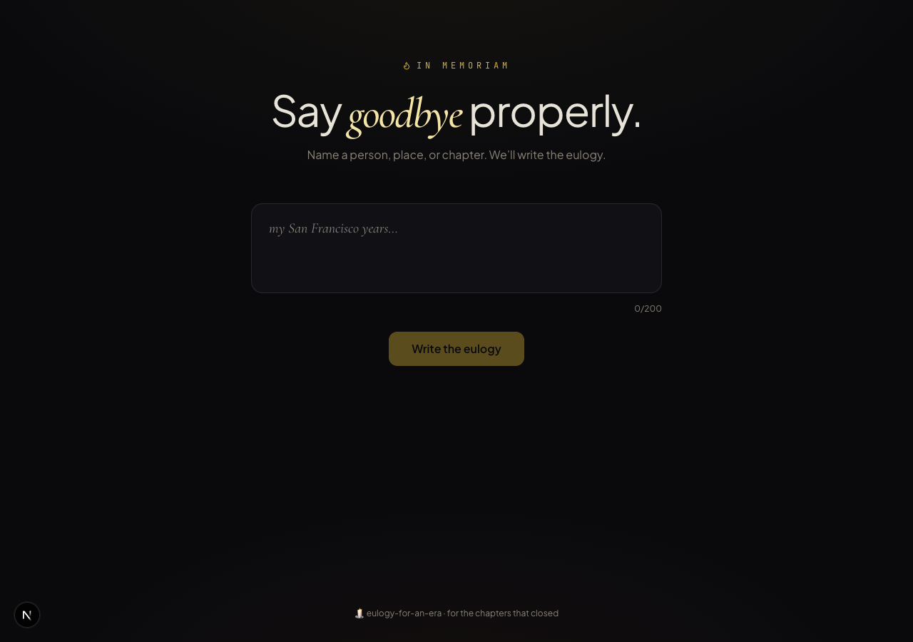

# 🕯️ Eulogy for an Era

> Say goodbye properly.

Type a person, place, relationship, job, era, or chapter of your life. AI writes a short, dignified eulogy in the spirit of Joan Didion meets a small-town funeral home. Downloadable as an in-memoriam memorial card.

## Stack

- Next.js 15 · App Router · TypeScript
- Tailwind CSS v4 (`@theme`)
- OpenAI `gpt-4o`
- `html-to-image` for PNG export
- Framer Motion · lucide-react
- Cormorant Garamond · Plus Jakarta Sans · JetBrains Mono

## Setup

```bash
pnpm install
cp .env.example .env.local
# add your OPENAI_API_KEY
pnpm dev
```

Open http://localhost:3000.

## License

MIT


